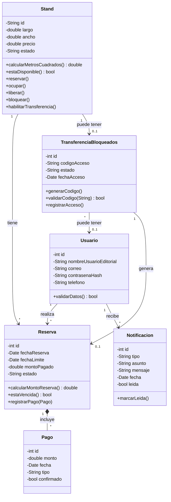
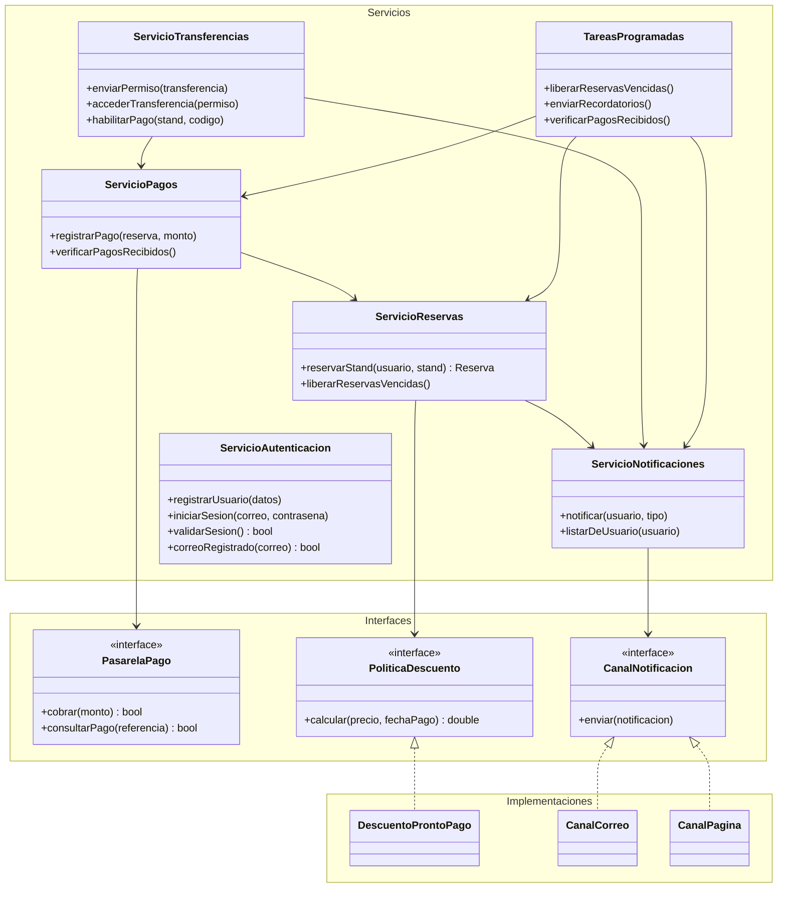
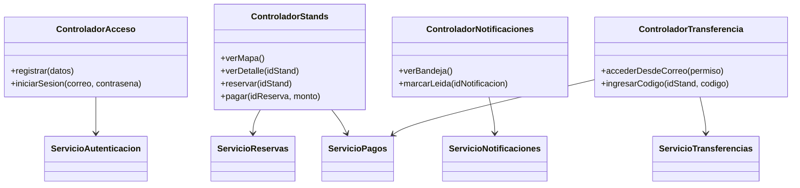

# Diagrama de clases del sistema de stands de la feria
 
Este documento contiene el diagrama de clases del sistema, dividido por capas del patrón MVC para que sea fácil de leer. Los diagramas están escritos en [Mermaid](https://mermaid.js.org/), que GitHub muestra automáticamente.
 
## Índice
 
1. [Cómo leer el diagrama](#1-cómo-leer-el-diagrama)
2. [Parte 1: Entidades](#2-parte-1-entidades)
3. [Parte 2: Servicios, interfaces e implementaciones](#3-parte-2-servicios-interfaces-e-implementaciones)
4. [Parte 3: Controladores](#4-parte-3-controladores)
---
 
## 1. Cómo leer el diagrama
 
### Tipos de flecha
 
| Símbolo | Nombre | Significado |
|---|---|---|
| `→` | Asociación / uso | La clase de donde sale conoce o usa a la clase donde llega. |
| `◆—` | Composición | La clase del rombo está compuesta por la otra; si desaparece el "todo", desaparecen sus partes. |
| `┄▷` | Implementación | Una clase cumple el contrato de una interfaz. |
 
### Multiplicidades
 
| Símbolo | Significado |
|---|---|
| `1` | Exactamente uno |
| `*` | Muchos |
| `0..1` | Ninguno o uno |
 
### Visibilidad
 
| Símbolo | Significado |
|---|---|
| `+` | Público |
| `-` | Privado |
 
---
 
## 2. Parte 1: Entidades
 
Son los datos principales del sistema y las relaciones entre ellos.
 

 
### Relaciones
 
| Relación | Descripción |
|---|---|
| `Usuario` 1 → `Reserva` * "realiza" | Un usuario puede hacer muchas reservas. |
| `Stand` 1 → `Reserva` * "tiene" | Un stand puede tener varias reservas a lo largo del tiempo. |
| `Reserva` 1 ◆— `Pago` * "incluye" | Una reserva incluye varios pagos (el 15% inicial y los siguientes). Sin la reserva, el pago no existe. |
| `Stand` 1 → `TransferenciaBloqueados` 0..1 "puede tener" | Solo los stands bloqueados tienen una transferencia. |
| `TransferenciaBloqueados` * → `Usuario` 0..1 "puede tener" | Una transferencia puede tener un usuario asociado; un mismo usuario puede estar en varias transferencias. |
| `TransferenciaBloqueados` 1 → `Reserva` 0..1 "genera" | Cuando el propietario paga la transferencia, se genera su reserva. Antes del pago no existe. |
| `Usuario` 1 → `Notificacion` * "recibe" | Un usuario recibe muchas notificaciones. |
 
---
 
## 3. Parte 2: Servicios, interfaces e implementaciones
 
Los servicios contienen las reglas de negocio. El diagrama está agrupado en tres bloques: **Servicios**, **Interfaces** e **Implementaciones**, y se lee de arriba hacia abajo: arriba están los que inician acciones, en medio los contratos (interfaces) y abajo las clases que los cumplen.
 
Los servicios dependen de **interfaces** y no de implementaciones concretas. Así se puede cambiar la pasarela de pago, los canales de notificación o la política de descuento sin modificar los servicios.
 

 
### Dependencias entre servicios
 
| Origen | Depende de | Para qué |
|---|---|---|
| `TareasProgramadas` | `ServicioReservas` | Liberar las reservas vencidas. |
| `TareasProgramadas` | `ServicioPagos` | Verificar qué pagos ya llegaron. |
| `TareasProgramadas` | `ServicioNotificaciones` | Enviar recordatorios de fecha límite. |
| `ServicioTransferencias` | `ServicioPagos` | Cobrar el pago de la transferencia. |
| `ServicioTransferencias` | `ServicioNotificaciones` | Enviar el permiso de transferencia por correo. |
| `ServicioPagos` | `ServicioReservas` | Actualizar la reserva cuando llega un pago. |
| `ServicioReservas` | `ServicioNotificaciones` | Enviar la confirmación de la reserva. |
 
`ServicioAutenticacion` no depende de ningún otro servicio.
 
### Interfaces e implementaciones
 
| Servicio | Usa la interfaz | Contrato | Implementaciones |
|---|---|---|---|
| `ServicioReservas` | `PoliticaDescuento` | `calcular(precio, fechaPago)` | `DescuentoProntoPago` |
| `ServicioPagos` | `PasarelaPago` | `cobrar(monto)`, `consultarPago(referencia)` | A definir |
| `ServicioNotificaciones` | `CanalNotificacion` | `enviar(notificacion)` | `CanalCorreo`, `CanalPagina` |
 
> **Sobre `PasarelaPago`:** representa el servicio externo que procesa los pagos (el sistema no maneja datos de tarjetas directamente). Aún no tiene implementación; puede empezar como una pasarela simulada.
 
---
 
## 4. Parte 3: Controladores
 
Los controladores reciben las acciones del usuario desde la vista y se las pasan a los servicios. No contienen reglas de negocio.
 

 
### Dependencias
 
| Controlador | Usa | Para qué |
|---|---|---|
| `ControladorAcceso` | `ServicioAutenticacion` | Registrar usuarios e iniciar sesión. |
| `ControladorStands` | `ServicioReservas` | Reservar stands. |
| `ControladorStands` | `ServicioPagos` | Registrar pagos. |
| `ControladorNotificaciones` | `ServicioNotificaciones` | Obtener las notificaciones del usuario. |
| `ControladorTransferencia` | `ServicioTransferencias` | Acceder a la transferencia y validar el código. |
| `ControladorTransferencia` | `ServicioPagos` | Habilitar y registrar el pago del stand transferido. |
 
