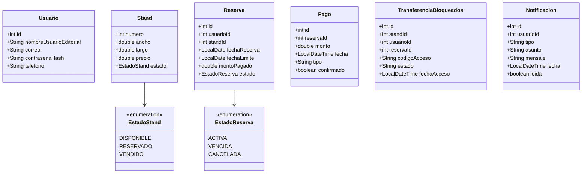
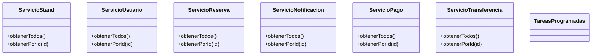
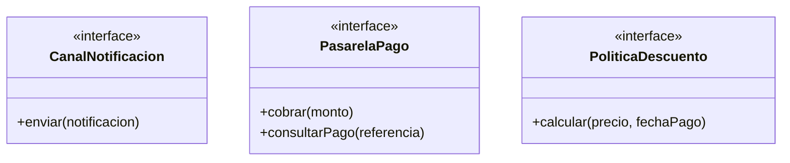
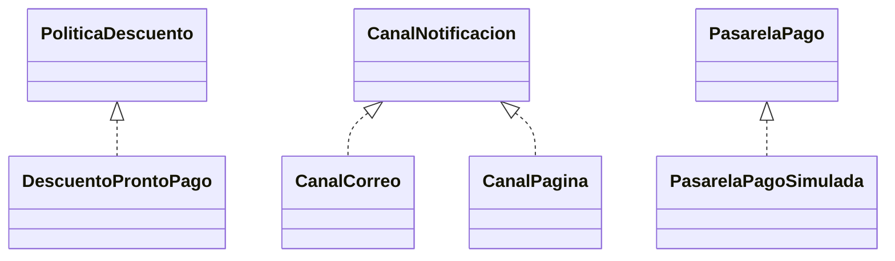
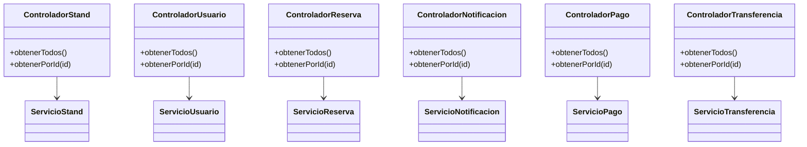
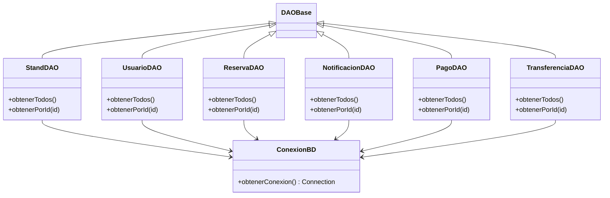
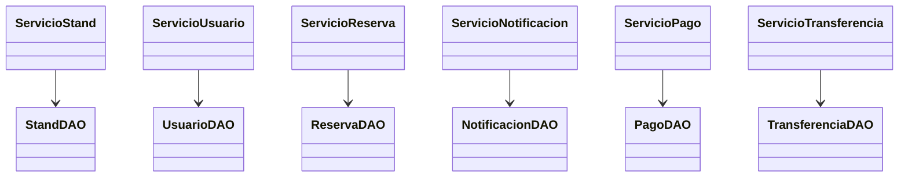
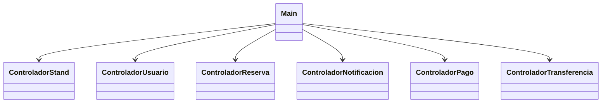
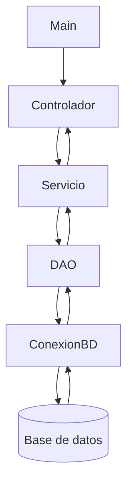

# Diagrama de clases del sistema de stands de la feria

Este documento contiene el diagrama de clases del sistema, organizado por capas para representar su arquitectura actual. Se utiliza una estructura basada en MVC, complementada con servicios, interfaces y una capa de persistencia mediante JDBC.

Los diagramas están escritos en [Mermaid](https://mermaid.js.org/), que GitHub muestra automáticamente.

## Índice

1. Cómo leer el diagrama
2. Parte 1: Modelos
3. Parte 2: Servicios, interfaces e implementaciones
4. Parte 3: Controladores
5. Parte 4: Persistencia y acceso a datos
6. Parte 5: Punto de entrada

---

## 1. Cómo leer el diagrama

### Tipos de flecha

| Símbolo | Nombre | Significado |
|---|---|---|
| `-->` | Asociación / dependencia | Una clase utiliza o depende de otra. |
| `--|>` | Herencia | Una clase hereda de otra. |
| `<|..` | Implementación | Una clase implementa una interfaz. |

### Visibilidad

| Símbolo | Significado |
|---|---|
| `+` | Público |
| `-` | Privado |

---

## 2. Parte 1: Modelos

Los modelos representan los datos principales del sistema. Actualmente, estas clases contienen atributos y no incluyen métodos de lógica de negocio.

### Características de los modelos

| Clase | Descripción |
|---|---|
| `Usuario` | Representa a una persona registrada en el sistema. |
| `Stand` | Representa un espacio disponible dentro de la feria. |
| `Reserva` | Almacena la información de una reservación. |
| `Pago` | Representa un pago asociado a una reserva. |
| `TransferenciaBloqueados` | Almacena la información de una transferencia de stands bloqueados. |
| `Notificacion` | Representa una notificación destinada a un usuario. |
| `EstadoStand` | Define los posibles estados de un stand. |
| `EstadoReserva` | Define los posibles estados de una reserva. |

**Nota:** Las relaciones entre entidades se representan mediante identificadores, como `usuarioId`, `standId` y `reservaId`. Esto permite relacionar los registros al recuperarlos desde la base de datos.

---

## 3. Parte 2: Servicios, interfaces e implementaciones

Los servicios contienen las operaciones y reglas del negocio. Se encargan de coordinar las operaciones que necesitan los controladores y de comunicarse con los DAO para recuperar información.

### Diagrama de servicios

### Interfaces

Las interfaces definen contratos que deben cumplir las clases que las implementan. Esto permite mantener separadas las reglas generales de sus implementaciones concretas.

### Implementaciones

### Descripción de las clases

| Clase | Responsabilidad |
|---|---|
| `ServicioStand` | Gestiona las operaciones de consulta de stands. |
| `ServicioUsuario` | Gestiona las operaciones de consulta de usuarios. |
| `ServicioReserva` | Gestiona las operaciones de consulta de reservas. |
| `ServicioNotificacion` | Gestiona las operaciones relacionadas con notificaciones. |
| `ServicioPago` | Gestiona las operaciones de consulta de pagos. |
| `ServicioTransferencia` | Gestiona las operaciones de consulta de transferencias. |
| `TareasProgramadas` | Agrupa tareas que pueden ejecutarse automáticamente. |
| `CanalNotificacion` | Define el contrato para los canales de notificación. |
| `PasarelaPago` | Define el contrato para el procesamiento de pagos. |
| `PoliticaDescuento` | Define el contrato para calcular descuentos. |
| `CanalCorreo` | Implementa las notificaciones mediante correo. |
| `CanalPagina` | Implementa las notificaciones dentro de la página. |
| `DescuentoProntoPago` | Implementa una política de descuento por pronto pago. |
| `PasarelaPagoSimulada` | Simula el procesamiento de pagos. |

---

## 4. Parte 3: Controladores

Los controladores reciben las solicitudes y las delegan a los servicios correspondientes. No deben contener directamente las consultas SQL ni concentrar la lógica del negocio.

### Dependencias

| Controlador | Servicio utilizado | Responsabilidad |
|---|---|---|
| `ControladorStand` | `ServicioStand` | Gestionar solicitudes relacionadas con stands. |
| `ControladorUsuario` | `ServicioUsuario` | Gestionar solicitudes relacionadas con usuarios. |
| `ControladorReserva` | `ServicioReserva` | Gestionar solicitudes relacionadas con reservas. |
| `ControladorNotificacion` | `ServicioNotificacion` | Gestionar solicitudes relacionadas con notificaciones. |
| `ControladorPago` | `ServicioPago` | Gestionar solicitudes relacionadas con pagos. |
| `ControladorTransferencia` | `ServicioTransferencia` | Gestionar solicitudes relacionadas con transferencias. |

---

## 5. Parte 4: Persistencia y acceso a datos

Esta capa se encarga de la comunicación con la base de datos mediante JDBC. Los DAO contienen las consultas SQL y los servicios los utilizan para recuperar la información.

### Diagrama de persistencia

### Dependencias entre servicios y DAO

### Responsabilidades

| Clase | Responsabilidad |
|---|---|
| `ConexionBD` | Establece y proporciona conexiones con la base de datos. |
| `DAOBase` | Funciona como clase padre para compartir funcionalidades entre los DAO. |
| `StandDAO` | Ejecuta consultas para recuperar stands. |
| `UsuarioDAO` | Ejecuta consultas para recuperar usuarios. |
| `ReservaDAO` | Ejecuta consultas para recuperar reservas. |
| `NotificacionDAO` | Ejecuta consultas para recuperar notificaciones. |
| `PagoDAO` | Ejecuta consultas para recuperar pagos. |
| `TransferenciaDAO` | Ejecuta consultas para recuperar transferencias. |

**Importante:** En esta versión, los DAO están preparados para operaciones de lectura (`SELECT`). Todavía no se implementan operaciones de escritura como `INSERT`, `UPDATE` o `DELETE`.

---

## 6. Parte 5: Punto de entrada

`Main.java` es el punto de entrada de la aplicación. Se encarga de inicializar los componentes necesarios para comenzar la ejecución del sistema.

---

## 7. Resumen de la arquitectura

| Capa | Responsabilidad principal |
|---|---|
| Modelo | Representar los datos del sistema. |
| Controladores | Recibir y coordinar solicitudes. |
| Servicios | Contener la lógica del negocio. |
| Interfaces | Definir contratos de comportamiento. |
| Implementaciones | Proporcionar implementaciones concretas. |
| Persistencia | Gestionar la conexión y el acceso a la base de datos. |
| DAO | Ejecutar consultas SQL. |

La comunicación principal del sistema sigue este flujo:

Esta organización permite separar responsabilidades y facilita el mantenimiento y la futura ampliación del sistema.