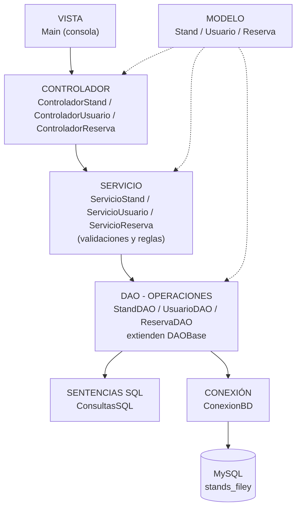
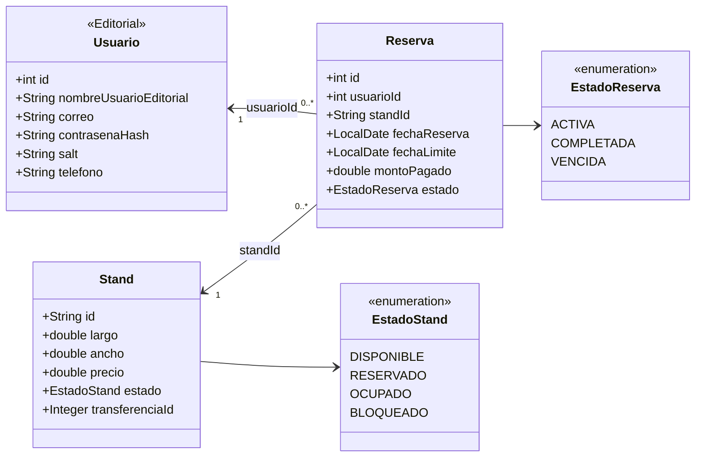
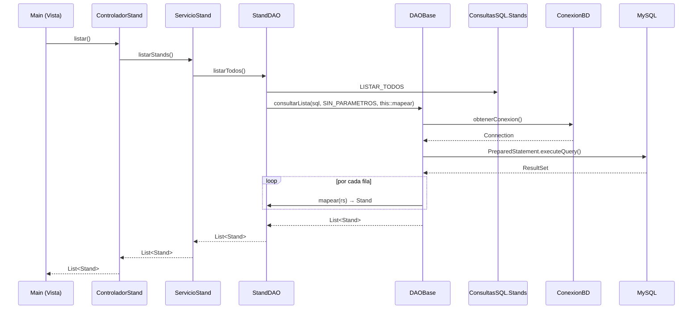
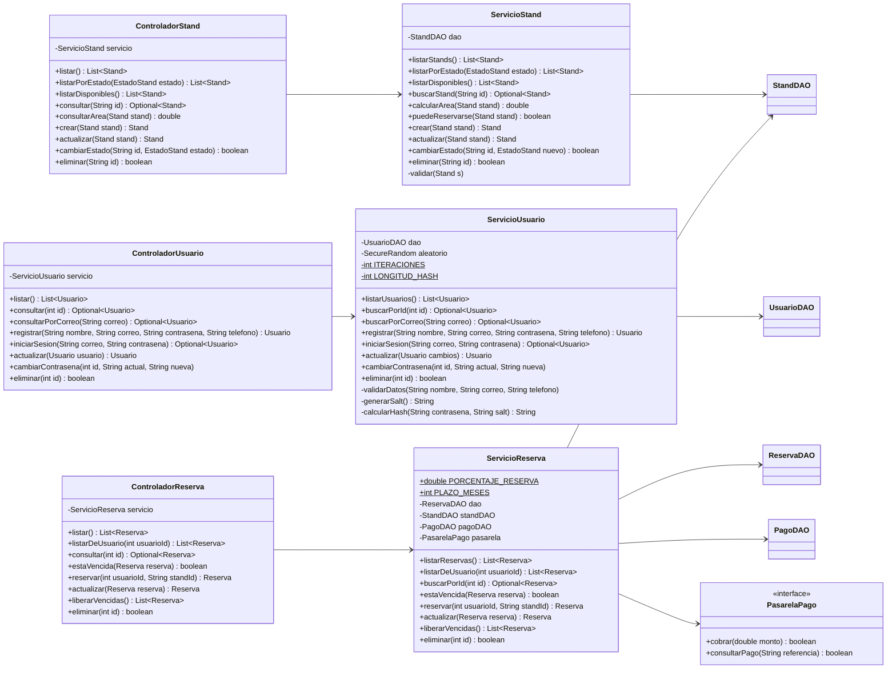
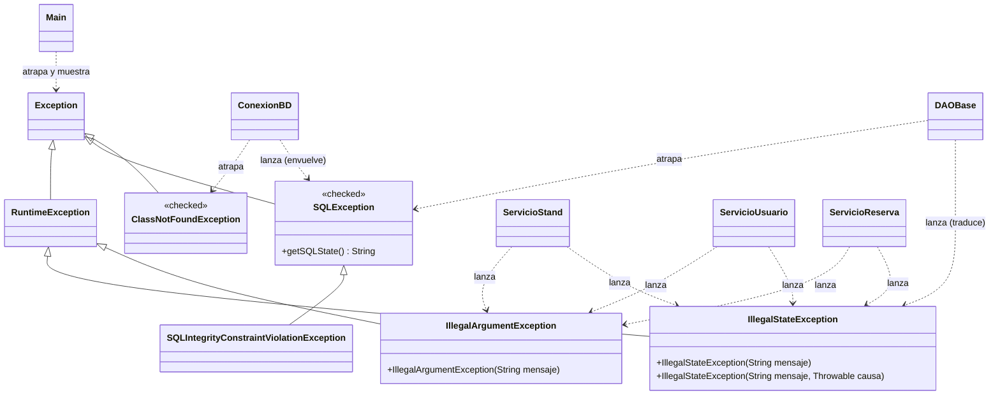
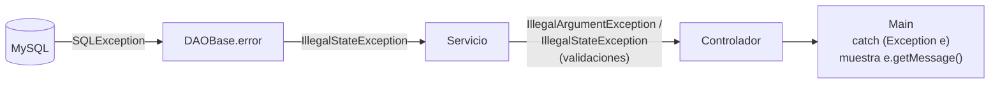
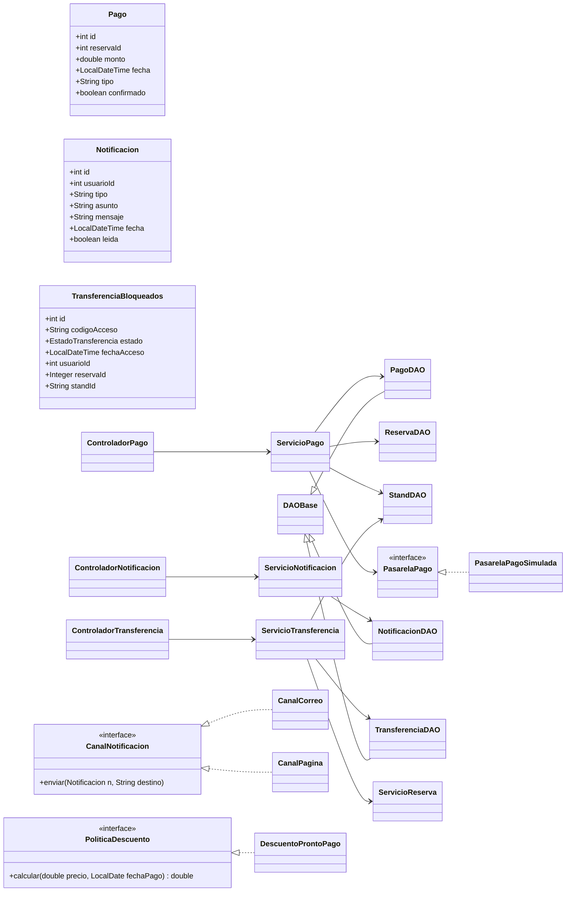
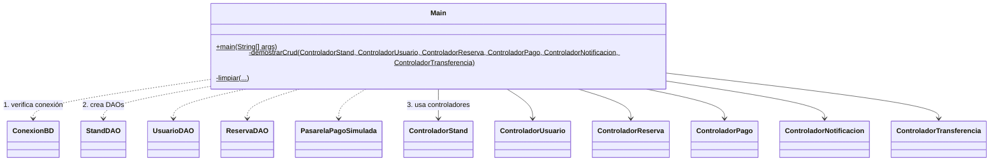

# Diagrama de clases — Sistema de Stands FILEY (PD5)

- El patrón **MVC + capa de BD (CRUD)**.
- La **separación entre la conexión a la BD y las operaciones sobre la BD**.
- Las entidades principales: **Stand**, **Editorial** y **Reservación**.
- La **estrategia de división del CRUD** por entidad.
- Las **excepciones** que maneja el paquete, dónde se lanzan y con qué argumentos.

Los diagramas están escritos en [Mermaid](https://mermaid.js.org/), que GitHub muestra automáticamente.

> **Nota sobre "Editorial":** en el código, la editorial se representa con la clase `Usuario` (tabla `usuarios`). Cada usuario registrado es una editorial y su nombre se guarda en el atributo `nombreUsuarioEditorial`. Por eso, en este documento, **Editorial = `Usuario`** y **Reservación = `Reserva`**.

## Índice

1. Cómo leer el diagrama
2. Vista general por capas (MVC + BD)
3. Modelo: Stand, Editorial y Reservación
4. Separación de conexión y operaciones en la BD
5. Capa de servicios y controladores (Stand, Editorial, Reservación)
6. Estrategia de división del CRUD por entidad
7. Excepciones
8. Resto del sistema (Pago, Notificación, Transferencia)
9. Punto de entrada `Main`

---

## 1. Cómo leer el diagrama

| Símbolo | Nombre | Significado |
|---|---|---|
| `-->` | Asociación / dependencia | Una clase usa a otra (la tiene como atributo o la llama). |
| `--|>` / `<|--` | Herencia | Una clase hereda de otra (`extends`). |
| `<|..` | Implementación | Una clase implementa una interfaz (`implements`). |
| `..>` | Dependencia de uso | Una clase usa a otra sin guardarla como atributo (p. ej. lanza una excepción). |
| `*--` | Composición | Una clase interna que solo existe dentro de otra. |

| Visibilidad | Significado |
|---|---|
| `+` | Público |
| `-` | Privado |
| `#` | Protegido |
| `$` (al final) | Estático |

---

## 2. Vista general por capas (MVC + BD)

| Capa MVC | Paquete | Clases |
|---|---|---|
| **Modelo** | `feria.modelo` | `Stand`, `Usuario` (Editorial), `Reserva`, enums de estado |
| **Vista** | `feria` | `Main` (vista de consola: muestra los resultados) |
| **Controlador** | `feria.controladores` | `ControladorStand`, `ControladorUsuario`, `ControladorReserva` |
| Lógica de negocio | `feria.servicios` | `ServicioStand`, `ServicioUsuario`, `ServicioReserva` |
| **BD — operaciones** | `feria.persistencia.dao` | `DAOBase`, `StandDAO`, `UsuarioDAO`, `ReservaDAO` |
| **BD — sentencias SQL** | `feria.persistencia` | `ConsultasSQL` |
| **BD — conexión** | `feria.persistencia` | `ConexionBD` |

El modelo viaja entre todas las capas: el DAO lo construye a partir de cada fila del `ResultSet`, el servicio lo valida y el controlador lo entrega a la vista.

---

## 3. Modelo: Stand, Editorial y Reservación

| Clase | Tabla | Llave primaria | Relación |
|---|---|---|---|
| `Stand` | `stands` | `id` (VARCHAR, p. ej. `"A-01"`) | Un stand puede tener varias reservas en el tiempo. |
| `Usuario` (Editorial) | `usuarios` | `id` (AUTO_INCREMENT) | Una editorial puede tener varias reservas. |
| `Reserva` | `reservas` | `id` (AUTO_INCREMENT) | Une a una editorial (`usuario_id`) con un stand (`stand_id`). |

---

## 4. Separación de conexión y operaciones en la BD

Esta es la parte central de la capa de BD. Se dividió en **tres responsabilidades independientes**:

1. **Conexión** → `ConexionBD`: lo único que hace es abrir una `Connection` JDBC. No sabe qué tablas existen.
2. **Sentencias SQL** → `ConsultasSQL`: el único lugar donde se escribe SQL. No abre conexiones ni ejecuta nada.
3. **Operaciones** → `DAOBase` + un DAO por entidad: ejecutan las sentencias usando la conexión y convierten las filas en objetos del modelo.

```mermaid
classDiagram
direction TB

namespace Conexion {
  class ConexionBD {
    <<final>>
    -String URL_DEFAULT$
    -String USER_DEFAULT$
    -String PASSWORD_DEFAULT$
    -ConexionBD()
    +obtenerConexion()$ Connection
  }
}

namespace SentenciasSQL {
  class ConsultasSQL {
    <<final>>
    -ConsultasSQL()
  }
  class Stands {
    <<static final>>
    +String LISTAR_TODOS$
    +String LISTAR_POR_ESTADO$
    +String BUSCAR_POR_ID$
    +String INSERTAR$
    +String ACTUALIZAR$
    +String CAMBIAR_ESTADO$
    +String CAMBIAR_ESTADO_SI_ESTA$
    +String ASIGNAR_TRANSFERENCIA$
    +String ELIMINAR$
  }
  class Usuarios {
    <<static final>>
    +String LISTAR_TODOS$
    +String BUSCAR_POR_ID$
    +String BUSCAR_POR_CORREO$
    +String INSERTAR$
    +String ACTUALIZAR$
    +String ACTUALIZAR_CONTRASENA$
    +String ELIMINAR$
  }
  class Reservas {
    <<static final>>
    +String LISTAR_TODOS$
    +String LISTAR_POR_USUARIO$
    +String LISTAR_POR_STAND$
    +String LISTAR_ACTIVAS_VENCIDAS$
    +String BUSCAR_POR_ID$
    +String INSERTAR$
    +String ACTUALIZAR$
    +String ACTUALIZAR_MONTO$
    +String CAMBIAR_ESTADO$
    +String ELIMINAR$
  }
}

namespace Operaciones {
  class DAOBase {
    <<abstract>>
    #Parametros SIN_PARAMETROS$
    #conectar() Connection
    #consultarLista(String sql, Parametros p, Mapeador~T~ m) List~T~
    #consultarUno(String sql, Parametros p, Mapeador~T~ m) Optional~T~
    #insertarYObtenerId(String sql, Parametros p) int
    #ejecutar(String sql, Parametros p) int
    #error(String accion, SQLException e) RuntimeException
    #setEnteroONulo(PreparedStatement, int, Integer)$
    #setFecha(PreparedStatement, int, LocalDate)$
    #setFechaHora(PreparedStatement, int, LocalDateTime)$
    #getEnteroONulo(ResultSet, String)$ Integer
    #getFecha(ResultSet, String)$ LocalDate
    #getFechaHora(ResultSet, String)$ LocalDateTime
  }
  class Mapeador~T~ {
    <<interface>>
    +mapear(ResultSet rs) T
  }
  class Parametros {
    <<interface>>
    +asignar(PreparedStatement ps)
  }
  class StandDAO {
    +listarTodos() List~Stand~
    +listarPorEstado(EstadoStand estado) List~Stand~
    +buscarPorId(String id) Optional~Stand~
    +insertar(Stand s) Stand
    +actualizar(Stand s) boolean
    +cambiarEstado(String id, EstadoStand nuevo) boolean
    +cambiarEstadoSiEsta(String id, EstadoStand esperado, EstadoStand nuevo) boolean
    +asignarTransferencia(String standId, Integer transferenciaId) boolean
    +eliminar(String id) boolean
    -mapear(ResultSet rs) Stand
  }
  class UsuarioDAO {
    +listarTodos() List~Usuario~
    +buscarPorId(int id) Optional~Usuario~
    +buscarPorCorreo(String correo) Optional~Usuario~
    +insertar(Usuario u) Usuario
    +actualizar(Usuario u) boolean
    +actualizarContrasena(int id, String hash, String salt) boolean
    +eliminar(int id) boolean
    -mapear(ResultSet rs) Usuario
  }
  class ReservaDAO {
    +listarTodos() List~Reserva~
    +listarPorUsuario(int usuarioId) List~Reserva~
    +listarPorStand(String standId) List~Reserva~
    +listarActivasVencidas(LocalDate hoy) List~Reserva~
    +buscarPorId(int id) Optional~Reserva~
    +insertar(Reserva r) Reserva
    +actualizar(Reserva r) boolean
    +actualizarMonto(int id, double montoPagado) boolean
    +cambiarEstado(int id, EstadoReserva nuevo) boolean
    +eliminar(int id) boolean
    -mapear(ResultSet rs) Reserva
  }
}

ConsultasSQL *-- Stands
ConsultasSQL *-- Usuarios
ConsultasSQL *-- Reservas

DAOBase *-- Mapeador
DAOBase *-- Parametros
DAOBase <|-- StandDAO
DAOBase <|-- UsuarioDAO
DAOBase <|-- ReservaDAO

DAOBase --> ConexionBD : conectar()
StandDAO ..> Stands : usa SQL
UsuarioDAO ..> Usuarios : usa SQL
ReservaDAO ..> Reservas : usa SQL
```

### ¿Por qué así?

| Clase | Qué sabe | Qué NO sabe |
|---|---|---|
| `ConexionBD` | URL, usuario y contraseña (variables `FERIA_DB_URL`, `FERIA_DB_USER`, `FERIA_DB_PASSWORD`) y el driver de MySQL. | Qué tablas existen ni qué consultas se hacen. |
| `ConsultasSQL` | El texto SQL de cada operación, agrupado por tabla en clases internas. | Cómo conectarse ni cómo ejecutar. |
| `DAOBase` | Cómo ejecutar cualquier SQL con JDBC: abrir conexión, `PreparedStatement`, `ResultSet`, cerrar todo con *try-with-resources* y traducir `SQLException`. | Qué tabla ni qué entidad está manejando. |
| `StandDAO`, `UsuarioDAO`, `ReservaDAO` | Qué sentencia usar, cómo asignar sus parámetros (`Parametros`) y cómo convertir una fila en objeto (`Mapeador`). | Cómo se abre la conexión ni cómo se cierran los recursos. |

Si cambia el servidor de BD, solo se toca `ConexionBD`. Si cambia una columna, solo se toca `ConsultasSQL` y el `mapear()` del DAO correspondiente.

### Lectura con JDBC (flujo de un SELECT)

El mismo flujo aplica para `UsuarioDAO` (Editorial) y `ReservaDAO` (Reservación); solo cambian la sentencia de `ConsultasSQL` y el método `mapear()`.

---

## 5. Capa de servicios y controladores (Stand, Editorial, Reservación)

---

## 6. Estrategia de división del CRUD por entidad

**Regla:** *una entidad = una tabla = un DAO = un servicio = un controlador.* Cada operación CRUD de una entidad vive en el DAO de esa entidad, y la sentencia SQL vive en la clase interna de `ConsultasSQL` con el mismo nombre de la tabla.

Las cuatro operaciones se resuelven siempre con el mismo método de `DAOBase`:

| Operación | Método de `DAOBase` | JDBC usado | Devuelve |
|---|---|---|---|
| **C**reate (id autogenerado) | `insertarYObtenerId()` | `executeUpdate()` + `getGeneratedKeys()` | `int` id nuevo |
| **C**reate (id propio, p. ej. Stand) | `ejecutar()` | `executeUpdate()` | filas afectadas |
| **R**ead (varios) | `consultarLista()` | `executeQuery()` | `List<T>` |
| **R**ead (uno) | `consultarUno()` | `executeQuery()` | `Optional<T>` |
| **U**pdate | `ejecutar()` | `executeUpdate()` | filas afectadas (`> 0` = éxito) |
| **D**elete | `ejecutar()` | `executeUpdate()` | filas afectadas (`> 0` = éxito) |

### Stand → `StandDAO` / `ConsultasSQL.Stands` / tabla `stands`

| CRUD | Método DAO | Sentencia SQL | Regla en `ServicioStand` |
|---|---|---|---|
| C | `insertar(Stand)` | `INSERTAR` | Valida id, dimensiones > 0, precio > 0 y que no exista otro con el mismo id. |
| R | `listarTodos()`, `listarPorEstado(EstadoStand)`, `buscarPorId(String)` | `LISTAR_TODOS`, `LISTAR_POR_ESTADO`, `BUSCAR_POR_ID` | `listarDisponibles()` filtra por `DISPONIBLE`. |
| U | `actualizar(Stand)`, `cambiarEstado(...)`, `cambiarEstadoSiEsta(...)`, `asignarTransferencia(...)` | `ACTUALIZAR`, `CAMBIAR_ESTADO`, `CAMBIAR_ESTADO_SI_ESTA`, `ASIGNAR_TRANSFERENCIA` | `cambiarEstadoSiEsta` es atómico para evitar dobles reservas. |
| D | `eliminar(String)` | `ELIMINAR` | No se elimina si el stand está `RESERVADO` u `OCUPADO`. |

### Editorial → `UsuarioDAO` / `ConsultasSQL.Usuarios` / tabla `usuarios`

| CRUD | Método DAO | Sentencia SQL | Regla en `ServicioUsuario` |
|---|---|---|---|
| C | `insertar(Usuario)` | `INSERTAR` | Valida nombre, correo, teléfono y contraseña (≥ 6); correo único; guarda hash PBKDF2 + salt. |
| R | `listarTodos()`, `buscarPorId(int)`, `buscarPorCorreo(String)` | `LISTAR_TODOS`, `BUSCAR_POR_ID`, `BUSCAR_POR_CORREO` | `iniciarSesion()` lee por correo y compara el hash. |
| U | `actualizar(Usuario)`, `actualizarContrasena(int, String, String)` | `ACTUALIZAR`, `ACTUALIZAR_CONTRASENA` | Valida que el nuevo correo no sea de otra cuenta y que la contraseña actual sea correcta. |
| D | `eliminar(int)` | `ELIMINAR` | La BD rechaza el borrado si la editorial tiene reservas (FK `RESTRICT`). |

### Reservación → `ReservaDAO` / `ConsultasSQL.Reservas` / tabla `reservas`

| CRUD | Método DAO | Sentencia SQL | Regla en `ServicioReserva` |
|---|---|---|---|
| C | `insertar(Reserva)` | `INSERTAR` | El stand debe existir y estar `DISPONIBLE`; se cobra el 15% (se registra también el `Pago` inicial) y la fecha límite es a 1 mes. Si algo falla, el stand se regresa a `DISPONIBLE`. |
| R | `listarTodos()`, `listarPorUsuario(int)`, `listarPorStand(String)`, `listarActivasVencidas(LocalDate)`, `buscarPorId(int)` | `LISTAR_TODOS`, `LISTAR_POR_USUARIO`, `LISTAR_POR_STAND`, `LISTAR_ACTIVAS_VENCIDAS`, `BUSCAR_POR_ID` | `liberarVencidas()` usa las activas vencidas para regresar el stand a `DISPONIBLE`. |
| U | `actualizar(Reserva)`, `actualizarMonto(int, double)`, `cambiarEstado(int, EstadoReserva)` | `ACTUALIZAR`, `ACTUALIZAR_MONTO`, `CAMBIAR_ESTADO` | Valida fechas coherentes y monto no negativo. |
| D | `eliminar(int)` | `ELIMINAR` | Si la reserva estaba `ACTIVA`, el stand regresa de `RESERVADO` a `DISPONIBLE`. |

**Operaciones que cruzan entidades:** cuando una operación toca más de una tabla (por ejemplo, `reservar()` inserta en `reservas` y cambia el estado en `stands`), la coordinación la hace el **servicio**, nunca el DAO. Cada DAO solo toca su propia tabla.

---

## 7. Excepciones

El paquete **no define excepciones propias**; usa excepciones estándar de Java, separadas por capa. La idea es que la `SQLException` (checked) nunca salga de la capa de BD: `DAOBase` la traduce a una excepción *unchecked* con un mensaje claro.

### Dónde se colocaron y qué argumentos las disparan

| Excepción | Clase / método que la lanza | Argumentos o condición que la disparan |
|---|---|---|
| `SQLException` (envuelve `ClassNotFoundException`) | `ConexionBD.obtenerConexion()` | El driver `com.mysql.cj.jdbc.Driver` no está en el classpath (`lib/mysql-connector-j.jar`). |
| `SQLException` | `ConexionBD.obtenerConexion()` → `DriverManager.getConnection(url, usuario, contrasena)` | URL, usuario o contraseña incorrectos, o el servidor MySQL apagado. |
| `IllegalStateException` ("Operación rechazada por la base de datos…") | `DAOBase.error(accion, e)` | La `SQLException` es `SQLIntegrityConstraintViolationException` o su SQLState es `23000`: llave duplicada o FK violada (p. ej. borrar una editorial con reservas). |
| `IllegalStateException` ("No se pudo *accion* en la base de datos…") | `DAOBase.error(accion, e)` desde `consultarLista` (`"consultar"`), `insertarYObtenerId` (`"insertar"`) o `ejecutar` (`"guardar cambios"`) | Cualquier otro error de SQL (tabla inexistente, columna mal escrita, conexión caída). |
| `IllegalStateException` | `DAOBase.insertarYObtenerId(sql, parametros)` | La BD no devolvió el id generado. |
| `IllegalArgumentException` | `ServicioStand.validar(Stand s)` (desde `crear` / `actualizar`) | `s.id` vacío; `largo` o `ancho` ≤ 0; `precio` ≤ 0. |
| `IllegalArgumentException` | `ServicioStand.crear(Stand stand)` | Ya existe un stand con ese `id`. |
| `IllegalArgumentException` | `ServicioStand.actualizar(Stand stand)` | No existe un stand con ese `id`. |
| `IllegalStateException` | `ServicioStand.eliminar(String id)` | El stand está `RESERVADO` u `OCUPADO`. |
| `IllegalArgumentException` | `ServicioUsuario.registrar(nombre, correo, contrasena, telefono)` | Algún dato vacío; correo con formato inválido; teléfono sin 10–15 dígitos; contraseña < 6 caracteres; correo ya registrado. |
| `IllegalArgumentException` | `ServicioUsuario.actualizar(Usuario cambios)` | No existe la editorial con ese `id`, o el nuevo correo ya pertenece a otra editorial. |
| `IllegalArgumentException` | `ServicioUsuario.cambiarContrasena(id, actual, nueva)` | No existe la editorial, la contraseña actual no coincide o la nueva tiene < 6 caracteres. |
| `IllegalStateException` (envuelve `NoSuchAlgorithmException` / `InvalidKeySpecException`) | `ServicioUsuario.calcularHash(contrasena, salt)` | No se pudo calcular el hash PBKDF2. |
| `IllegalArgumentException` | `ServicioReserva.reservar(int usuarioId, String standId)` | No existe el stand `standId`. |
| `IllegalStateException` | `ServicioReserva.reservar(int usuarioId, String standId)` | El stand no está `DISPONIBLE`; el stand está en transferencia y no se validó el código; la pasarela rechazó el cobro; otro usuario lo reservó al mismo tiempo (`cambiarEstadoSiEsta` devolvió `false`). |
| `IllegalArgumentException` | `ServicioReserva.actualizar(Reserva reserva)` | No existe la reserva; fechas no válidas; `montoPagado` negativo. |
| `Exception` (captura general) | `Main.main(String[] args)` | Atrapa cualquier error anterior para mostrar el mensaje en consola sin romper el programa; si falla la conexión inicial, termina. |

### Recorrido de una excepción

---

## 8. Resto del sistema (Pago, Notificación, Transferencia)

Estas entidades siguen exactamente la misma estructura (Controlador → Servicio → DAO → `ConsultasSQL` → `ConexionBD`) y también implementan CRUD completo.

---

## 9. Punto de entrada `Main`

`Main` actúa como **vista de consola** y es quien arma todas las capas.

Lo que hace `main()`:

1. **Prueba la conexión** con `ConexionBD.obtenerConexion()` e imprime el nombre de la BD (`conn.getCatalog()`). Si falla, muestra el error y termina.
2. **Arma las capas** inyectando dependencias por constructor: DAO → Servicio → Controlador.
3. **READ:** muestra cuántos registros hay de cada entidad (stands, editoriales, reservas, pagos, transferencias, notificaciones).
4. **CRUD completo:** `demostrarCrud()` crea, lee, actualiza y elimina datos temporales de cada entidad, incluyendo casos que disparan excepciones a propósito.
5. **Limpieza:** `limpiar()` borra los datos de prueba para que la BD quede igual que antes.