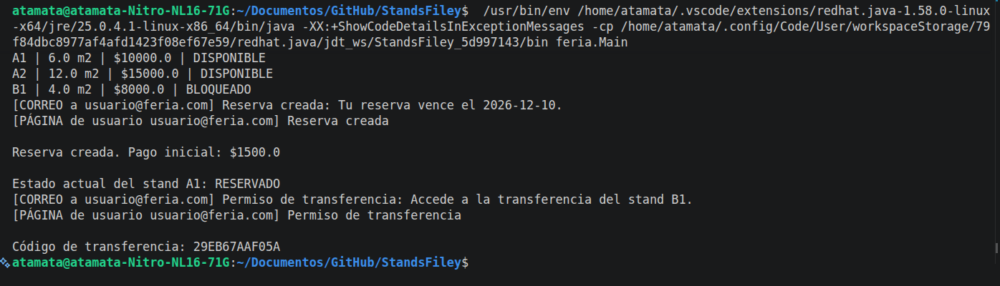
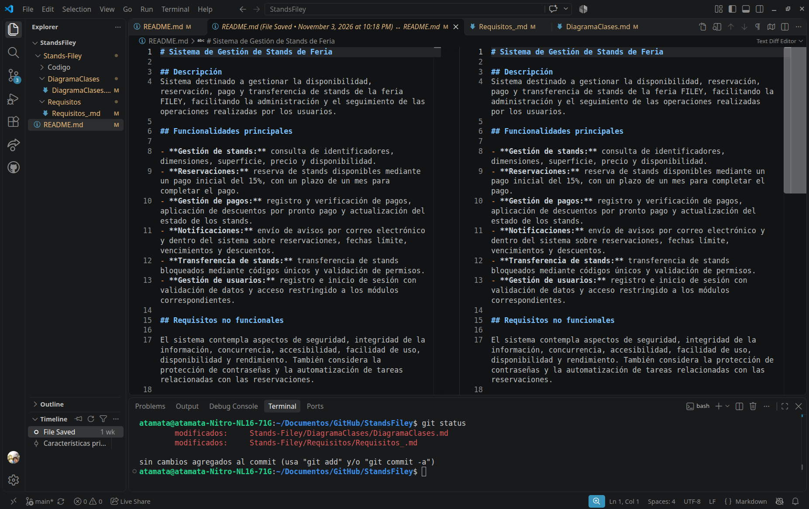
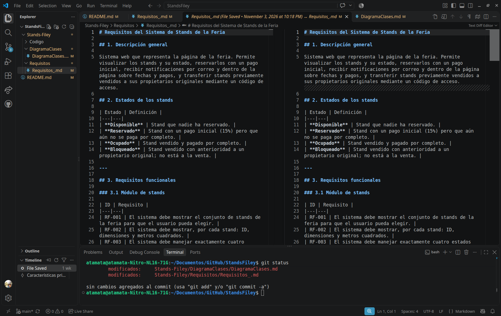
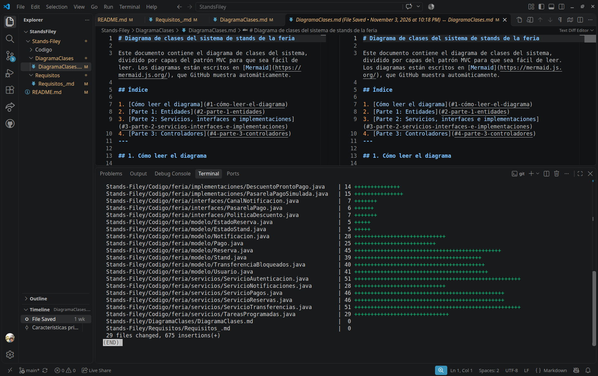
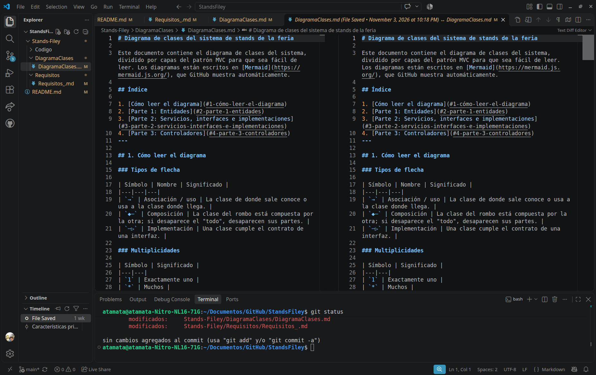

# LINK VIDEO

canva: https://canva.link/y0o0gdbo9r6ven1

## Impresion del programa en terminal

# Problema de commit

El primer commit de este repositorio coincide con las fechas en las que debíamos enviar el trabajo, sin embargo cuando se entra a ese commit se puede ver que todos los archivos salieron vacios, excpeción del código, esto se debe a un error de añadir los archivos al commit. No me percaté que no se habían subido los demás archivos, solo vi el readme vacio.
Sin embargo, aquí dejo imágenes del historial de vscode mostrando que estos archivos estaban listos y escritos unos minutos antes de hacer el primer commit a la hora de entrega.
Espero pueda aceptar el trabajo, una disculpa por la equivocación del commit.

## Información del commit
;

## Historial VsCode

